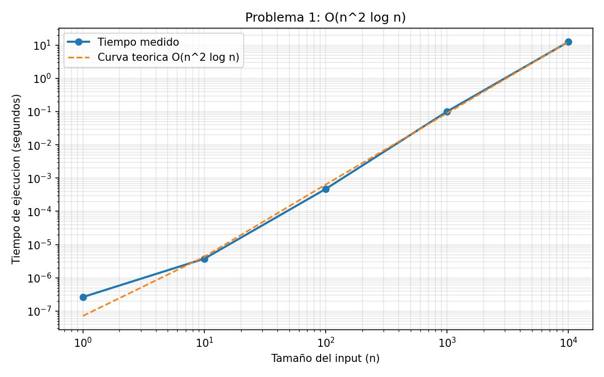
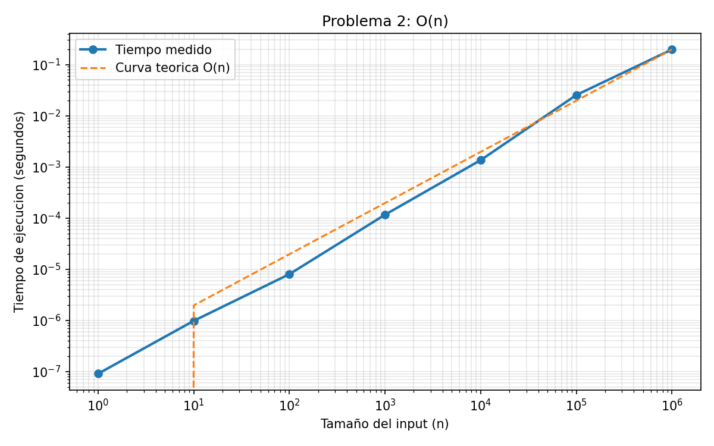
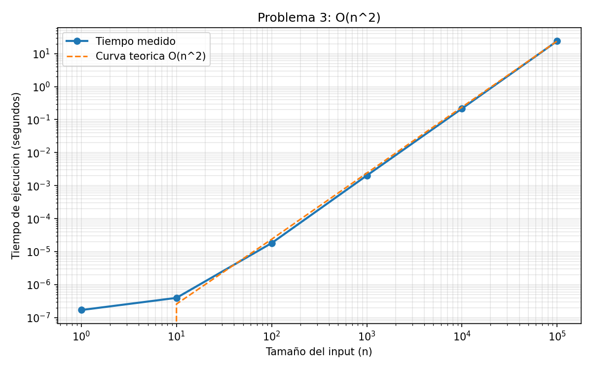

# Laboratorio 8 - Teoría de la Computación

Análisis de complejidad y profiling de tres algoritmos, más los ejercicios teóricos
de casos (mejor, promedio, peor) y de verdadero/falso sobre notación asintótica.

**Universidad del Valle de Guatemala**
Fatima Navarro, carné 24044

## Video de demostración

[Enlace al video en YouTube](https://youtu.be/IqBvg0sUnUM)

## Estructura del repositorio

```
.
├── README.md
├── requirements.txt
├── src/
│   ├── profiling_utils.py    # utilidades de medición, tablas y gráficas
│   ├── problema1.py          # O(n^2 log n)
│   ├── problema2.py          # O(n)
│   ├── problema3.py          # O(n^2)
│   └── run_all.py            # corre los tres de un solo
├── resultados/               # CSV y PNG generados
└── respuestas/
    └── respuestas.pdf        # problemas 1a, 2a, 3a, 4 y 5
```

## Instrucciones de ejecución

Requisitos: Python 3.8 o superior.

```bash
# 1. Clonar el repositorio
git clone https://github.com/fatupopzz/NOMBRE_DEL_REPO.git
cd NOMBRE_DEL_REPO

# 2. Crear el entorno virtual e instalar dependencias
python3 -m venv venv
source venv/bin/activate        # en Windows: venv\Scripts\activate
pip install -r requirements.txt

# 3. Correr los tres problemas de un solo
python src/run_all.py

# O correr uno por separado
python src/problema1.py
python src/problema2.py
python src/problema3.py
```

Los CSV y las gráficas quedan en `resultados/`.

## Metodología del profiling

- El tiempo se mide con `time.perf_counter()`, que es el reloj de mayor resolución
  disponible en Python.
- Para n pequeño el reloj no alcanza a distinguir una sola corrida, así que cada
  caso se repite varias veces y se toma el **mínimo**. Se usa el mínimo y no el
  promedio porque el sistema operativo solo puede hacer que una corrida tarde más,
  nunca menos, entonces el mínimo es el valor con menos ruido.
- Los `printf("Sequence\n")` de los problemas 2 y 3 se reemplazan por un contador.
  Imprimir cientos de millones de líneas mide la velocidad de la terminal, no la del
  algoritmo. El número de iteraciones es exactamente el mismo.
- Los casos que requieren más de `MAX_OPS = 1,000,000,000` iteraciones no se
  ejecutan y se reportan como **no terminó**. En la máquina de prueba Python hace
  cerca de 1.8e7 iteraciones por segundo, así que ese tope equivale a alrededor de
  un minuto de espera por caso. El Problema 1 con n = 1,000,000 necesitaría 4.25e11
  iteraciones, o sea más de seis horas.
- Las gráficas usan **escala log-log**. Con n de 1 a 1,000,000 una escala lineal
  dejaría todos los puntos pequeños pegados al eje. Además, en log-log una función
  polinomial se ve como una recta cuya pendiente es el exponente, lo que permite
  verificar la complejidad visualmente.

## Resultados

### Problema 1: O(n² log n)

| n | Tiempo (s) | Iteraciones |
|---|---|---|
| 1 | 0.000000 | 2.000e+00 |
| 10 | 0.000004 | 1.200e+02 |
| 100 | 0.000472 | 1.785e+04 |
| 1,000 | 0.100769 | 2.505e+06 |
| 10,000 | 12.551966 | 3.501e+08 |
| 100,000 | no terminó | 4.250e+10 |
| 1,000,000 | no terminó | 5.000e+12 |



De n = 1,000 a n = 10,000 el tiempo pasa de 0.10 s a 12.55 s, un factor de
**124x** al multiplicar n por 10. El factor teórico para n² log n es
100 · (log 10,000 / log 1,000) ≈ 133, así que la medición confirma el análisis.

### Problema 2: O(n)

| n | Tiempo (s) | Iteraciones |
|---|---|---|
| 1 | 0.000000 | 0 |
| 10 | 0.000001 | 1.000e+01 |
| 100 | 0.000008 | 1.000e+02 |
| 1,000 | 0.000116 | 1.000e+03 |
| 10,000 | 0.001356 | 1.000e+04 |
| 100,000 | 0.025359 | 1.000e+05 |
| 1,000,000 | 0.196688 | 1.000e+06 |



Este es el único de los tres que completa **todos** los valores de n, y lo hace en
menos de 0.2 segundos. Cada vez que n se multiplica por 10, el tiempo se multiplica
por cerca de 10, que es justo el comportamiento lineal.

### Problema 3: O(n²)

| n | Tiempo (s) | Iteraciones |
|---|---|---|
| 1 | 0.000000 | 0 |
| 10 | 0.000000 | 9.000e+00 |
| 100 | 0.000018 | 8.250e+02 |
| 1,000 | 0.002024 | 8.325e+04 |
| 10,000 | 0.216402 | 8.332e+06 |
| 100,000 | 23.954448 | 8.333e+08 |
| 1,000,000 | no terminó | 8.333e+10 |



De n = 10,000 a n = 100,000 el tiempo pasa de 0.22 s a 23.95 s, un factor de
**111x**, muy cerca del 100x que predice n². Extrapolando, n = 1,000,000 tomaría
alrededor de 40 minutos.

## Conclusiones

1. Las tres curvas medidas siguen de cerca a sus curvas teóricas, lo que valida el
   análisis en notación Big-Oh.
2. El Problema 2 muestra por qué no se puede analizar por la forma del código: tiene
   dos ciclos anidados que *parecen* dar O(n²), pero el `break` corta el ciclo
   interno en la primera iteración y el algoritmo resulta lineal.
3. Las constantes que se descartan en Big-Oh sí importan en la práctica. El
   Problema 3 es n²/12, no n², y por eso llega a n = 100,000 mientras que el
   Problema 1, que es n² log n / 4, se queda en n = 10,000.
